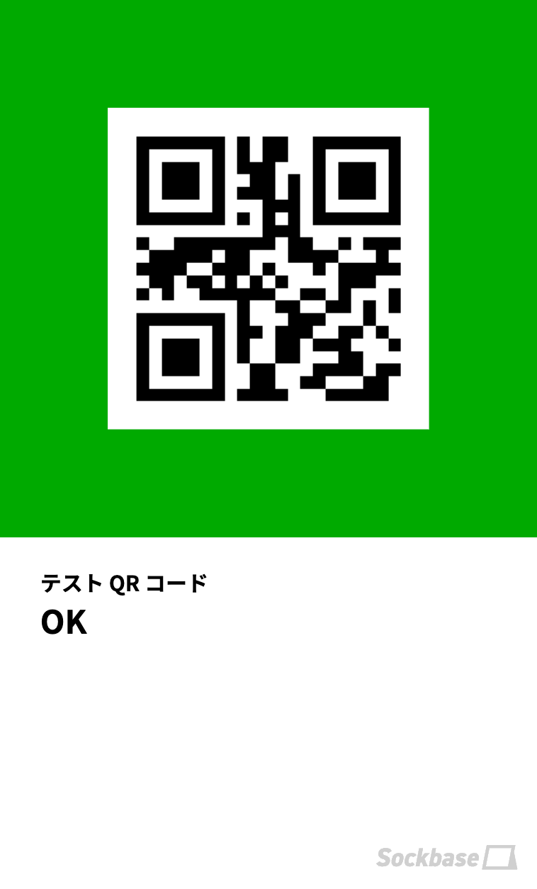
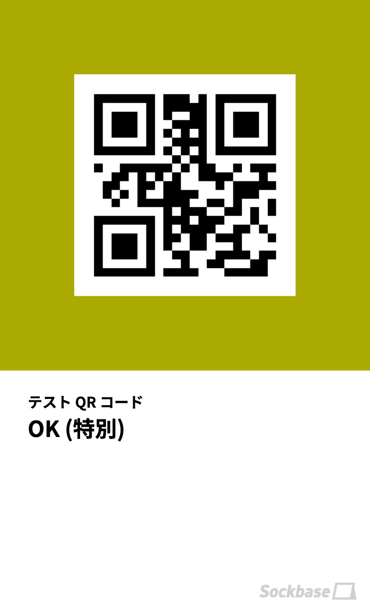
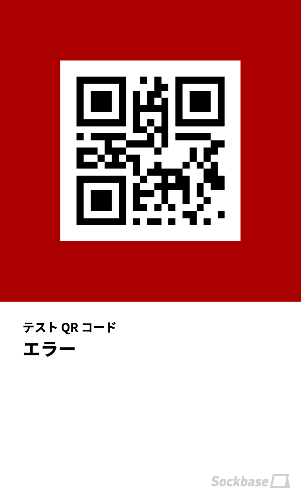
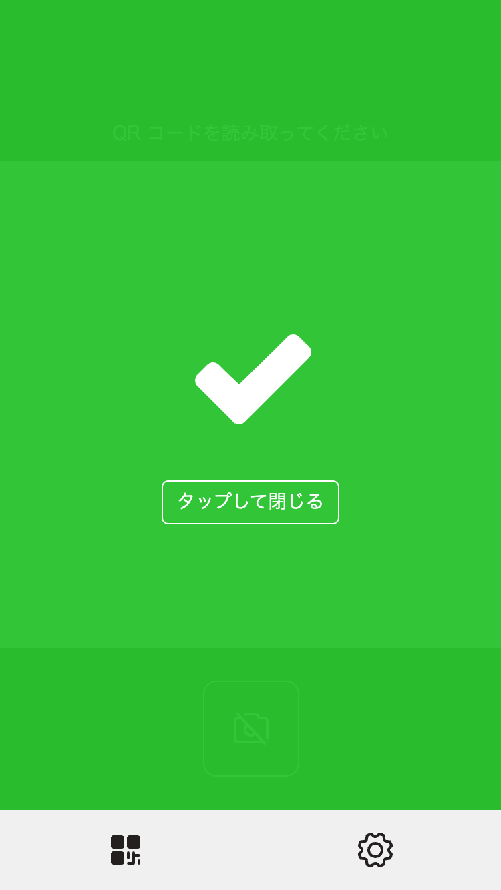
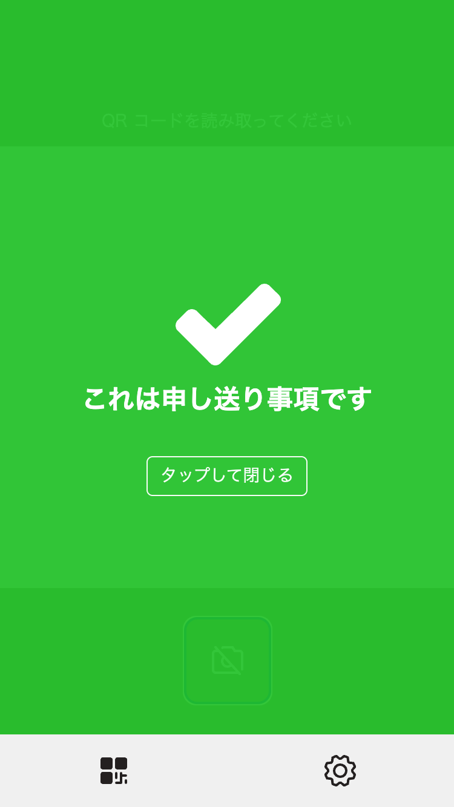

Sockbase SCANNER (以下本アプリ) は、Sockbase で発券されたチケット用の消し込みアプリです。

## 使用方法

本アプリを使用するには、以下の操作が必要です。

1. ログイン用 QR コードを読み取り、ログインする
1. チケット QR コードを読み取る

## ログイン

イベント主催者から提供されたログイン用 QR コードを読み取ります。

## テスト QR コード

下記の QR コードを使うと、本アプリの動作を確認することができます。  
実際の通信は行われません。  
別イベントのチケットが読み込まれた場合などのテストを行いたい場合は、専属担当者までご相談ください。

| 成功 | 成功 (申し送り事項有り) | エラー |
| - | - | - |
|  |  |  |

## チケット QR コードを読み取る

参加者から提示された QR コードを読み取ります

### 成功時

緑背景にチェックマークが表示されます

* 成功となる表示される条件
  * 受付対象のチケットストアのチケットであること
  * チケットの申し込みステータスが「申し込み確定」であること
  * 使用者割当が完了している もしくは スタンドアロンチケットであること
  * 未使用であること

### 成功時 (申し送り事項がある場合)

チケットに申し送り事項が設定されていると、特殊音と共に申し送り事項が表示されます。

### 失敗時

チケットを正常に処理できない場合、下記のエラーが発生します。

| エラー表示 | 主な原因 | 対処方法 |
| - | - | - |
| ログインが必要 | ログインされていません | ログイン用 QR コードを読み取ってください。 |
| テスト | エラーテスト用の QR コードが読み込まれました | 正常です。 |
| 不明な QR コード | Sockbase SCANNER で処理できないチケットが読み込まれました | 正しい QR コードを読み取ってください。 |
| チケット情報が見つからない・別イベントのチケット | 別イベントのチケットが読み込まれた可能性があります | 正しいチケットを読み込んでください。 |
| 担当者へ連絡してください (このチケットはまだ有効化されていません) | 申し込み確定されていないチケットが読み込まれました。 | イベント主催者に、表示された申し込み番号を添えて連絡してください。主催の方は、チケットの申し込みステータスを「申し込み確定」にしてください。 |
| キャンセル済み | キャンセル済みのチケットが読み込まれました | 別のチケットがある場合はそれを読み込んでください。 |
| 使用者設定が未完了 | 使用者割当が完了していないチケットが読み込まれました | 参加者に対して、チケット画面の「チケットを有効化する」をタップするか、チケットの分配を依頼してください。 |
| 使用済み | 使用済みのチケットが読み込まれました | 未使用のチケットを読み込んでください |

「担当者へ連絡してください」エラーはイベント主催者の対応が必要になります。  
主催の方が対応できないエラーが発生した場合は、Sockbase サポートダイヤルまでご連絡ください。
